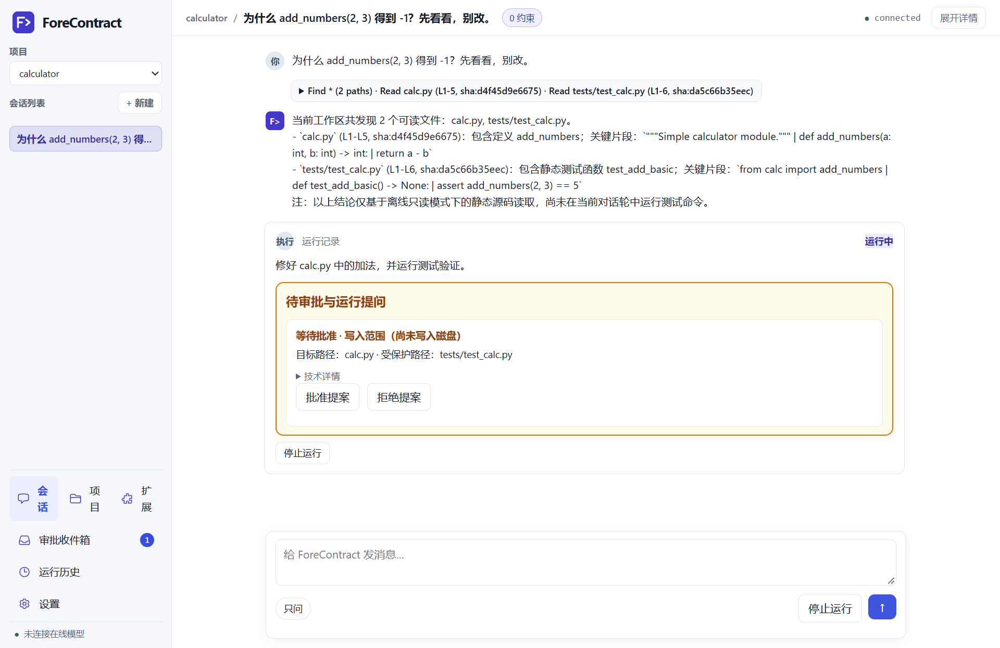
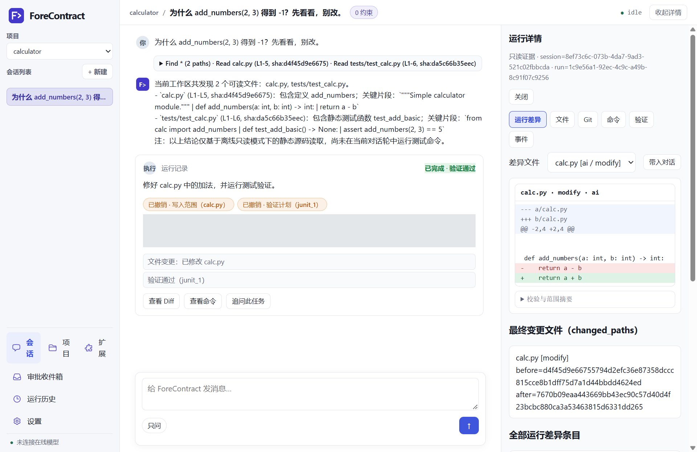

# ForeContract Desktop

[English](README.md)

“先帮我看看为什么算错，别急着改。”

这是我希望一次编程会话可以开始的方式。项目里有个加法函数，传入 2 和 3，却得到 -1。此时你可能只是想听一个解释：它读到了哪一行？现有测试覆盖了什么？等你确定值得改，再接着说：“那就把它修好，跑个测试看看。”刚才读过的文件、说过的话，都属于同一个问题，你可以留在原来的会话里。

ForeContract Desktop 是这样一个 Windows 编程助手。讨论转入实际修改时，工作台会让你看到模型打算动哪些文件，以及准备怎样验证。写入范围和验证计划获批后，它才可以编辑；本机真正要运行的命令还会交给你单独确认。审批的用意很具体：你也许同意改一行加法，却想先看一眼那条要在自己电脑上执行的命令。



同一会话中，助手读过源码和测试；下方正在等待批准修改 `calc.py`，还没有写盘。两图来自当前 Electron 客户端、合成计算器项目和本地离线 provider。

**我最希望这个界面保留下来的，是一次没有完全成功的工作。** 假如那一行已经改对了，测试却因为路径写错而失败，你可以打开这次运行的 Diff，看减号有没有变成加号，也可以打开命令结果，看测试到底跑到了哪里。这两个事实都值得保留。过一会儿回到项目，原先的修改和失败记录还在同一次运行下面，你不用靠记忆猜它做到哪了。模型对话需要配置在线模型，生成的计划也仍需要人判断，尤其值得看的是它选的测试能否真的覆盖这次修改。



这次运行中，`calc.py` 的减号变成了加号，`junit_1` 通过。截图已遮盖含本机绝对路径的命令行。

### 为什么桌面应用和框架分开放？

在桌面上，最重要的是能把一个问题谈清楚，在需要时放心地让助手动手。往下一层，才是另一个有意思的问题：模型怎样在动手前说清预期，运行时又怎样判断实际效果？我把后者放在独立的 Python 框架里。对这个设计或它的局限感兴趣，可以读那边关于 **OFCEVR Loop** 的介绍。[ForeContract 框架](https://github.com/zale-pan/ForeContract/blob/main/README.zh-CN.md)

### 在 Windows 上试用

**目前建议从源码运行桌面端**，Windows x64 的完整命令见下方。工作台支持简体中文和 English。从源码启动时，可以在打开 Electron 前设置 `$env:FC_DESKTOP_LOCALE = 'zh-CN'` 或 `'en'` 来指定语言。

Windows 安装包仍在试验中。在一次 Windows 实测中，安装及首次启动成功，托盘退出后开始菜单快捷方式无法再次启动；Symantec Endpoint Protection 对已安装的启动器记录了启发式检测，原因尚未确认。

关闭窗口会收起到通知区域。从托盘打开可恢复窗口，选择「退出 ForeContract」可退出客户端和宿主。活动任务取消清理与宿主关停重叠仍是已知限制。下面的步骤会启动离线工作台；开头示例中的模型问答需要另行配置在线模式。

### 从哪段源码看起？

| 想了解或修改什么 | 入口 |
|---|---|
| 窗口、托盘和宿主进程 | [main.cjs](apps/desktop/main.cjs) 管窗口与托盘；[host.cjs](apps/desktop/host.cjs) 启动本地 Python 宿主并管理其生命周期。 |
| 会话、审批与运行结果 | [server.py](apps/local/forecontract_app/server.py) 定义 HTTP 接口，[service.py](apps/local/forecontract_app/service.py) 处理会话和运行。 |
| 聊天气泡、审批卡与 Diff 抽屉 | [index.html](apps/local/forecontract_app/static/index.html) 定义页面，[app.js](apps/local/forecontract_app/static/app.js) 读取宿主状态并渲染，[style.css](apps/local/forecontract_app/static/style.css) 控制布局。 |

第一次改界面，可以沿着“查看 Diff”按钮跟到 `app.js` 中的 `chooseInspectorTab("diff")`。下面的源码启动命令直接使用检出的桌面应用，改完静态资源后在同一环境重开窗口并刷新即可查看。

## 从源码启动（贡献者）

准备 Windows x64、PowerShell、Git 和 Python 3.12，安装依赖时需要联网。两个源码仓库分别命名为 ForeContract 和 ForeContract-Desktop，放在同一父目录下。从桌面仓库根目录开始，在同一 PowerShell 窗口依次运行两段命令。框架仓库需要包含 framework.lock.json 指定的提交；安装会直接从该提交导出源码，工作区中尚未提交的修改不会进入安装。

```powershell
$desktop = (Resolve-Path .).Path
$fw = (Resolve-Path ..\ForeContract).Path
$lock = Get-Content "$desktop\framework.lock.json" -Raw | ConvertFrom-Json
$run = Join-Path $env:LOCALAPPDATA ("FC-Desktop-" + [guid]::NewGuid())
New-Item -ItemType Directory $run | Out-Null
git -C $fw archive --format=zip -o "$run\framework.zip" $lock.commit
if ($LASTEXITCODE) { throw 'Framework revision unavailable' }
Expand-Archive "$run\framework.zip" "$run\source"
py -3.12 -m venv "$run\venv"
$env:FC_DESKTOP_PYTHON = "$run\venv\Scripts\python.exe"
$python = $env:FC_DESKTOP_PYTHON
$env:PYTHONPATH = ''
& $python -m pip install setuptools==84.0.0
if ($LASTEXITCODE) { throw 'Build dependency installation failed' }
& $python -m pip install --no-build-isolation -r "$desktop\apps\local\requirements.txt" "$run\source\packages\core" "$run\source\packages\planners\llm" "$run\source\packages\adapters\coding"
if ($LASTEXITCODE) { throw 'Desktop dependency installation failed' }
```

```powershell
$zip = "$run\electron-v45.4.1-win32-x64.zip"
Invoke-WebRequest 'https://github.com/electron/electron/releases/download/v45.4.1/electron-v45.4.1-win32-x64.zip' -OutFile $zip
if ((Get-FileHash $zip).Hash -ne '2ba6223afa9121f42831fefe92c434334907540165294fc56697449d12e7cfe9') { throw 'Electron SHA-256 mismatch' }
Expand-Archive $zip "$run\electron"
$env:FC_DESKTOP_ROOT = "$run\profile-root"
$env:FC_DESKTOP_PROJECT = "$run\profile-root\project"
$env:FC_DESKTOP_LIVE_CHAT = '0'
$env:PYTHONPATH = "$desktop\apps\local"
& "$run\electron\electron.exe" "$desktop\apps\desktop"
```


## 恢复中断的 Electron 下载

如果下载在解压前中断，保留原 PowerShell 窗口，继续使用已有的 `$run` 和 Python 环境。在浏览器中打开 [Electron v45.4.1 官方发布页](https://github.com/electron/electron/releases/tag/v45.4.1)，下载 `electron-v45.4.1-win32-x64.zip`；也可以换一个网络下载。将完整包和已中断的文件分开保存。出现提示时粘贴完整包的绝对路径，两端不用加引号。

```powershell
$zip = (Get-Item -LiteralPath (Read-Host 'Full path to the complete Electron ZIP')).FullName
if ((Get-FileHash -LiteralPath $zip -Algorithm SHA256).Hash -ne '2ba6223afa9121f42831fefe92c434334907540165294fc56697449d12e7cfe9') { throw 'Electron SHA-256 mismatch' }
Expand-Archive -LiteralPath $zip -DestinationPath "$run\electron" -ErrorAction Stop
```

解压成功后，从启动代码块的 `$env:FC_DESKTOP_ROOT = ...` 那一行继续，执行全部余下命令。若摘要不匹配，请先重新获取完整压缩包。

## 作者的话

我把这个桌面应用做出来，是想亲手用一用自己写的框架，看看它放进日常编程里到底顺不顺手。现在想把它开源，也想听听别人用起来是什么感觉。

做这个项目的过程，也是我学前端、后端和桌面开发的过程，很多地方还很生疏。如果哪一步让你犹豫了，或者你觉得“这里换个做法会舒服很多”，欢迎告诉我。 你可以在 [Issues](https://github.com/zale-pan/ForeContract-Desktop/issues) 留言，也可以直接写信给我。

Zale Pan · <hashuuki@gmail.com>

Copyright 2026 Zale Pan · Apache-2.0. [LICENSE](LICENSE) · [Third-party notices / 第三方声明](THIRD_PARTY_NOTICES.md).
